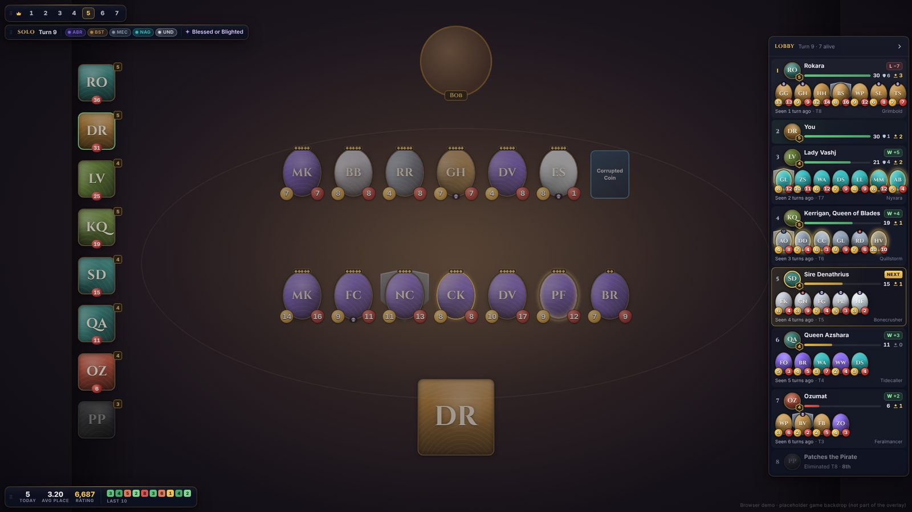
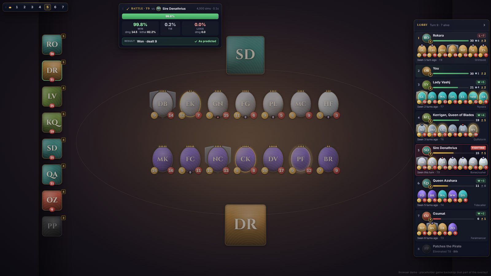
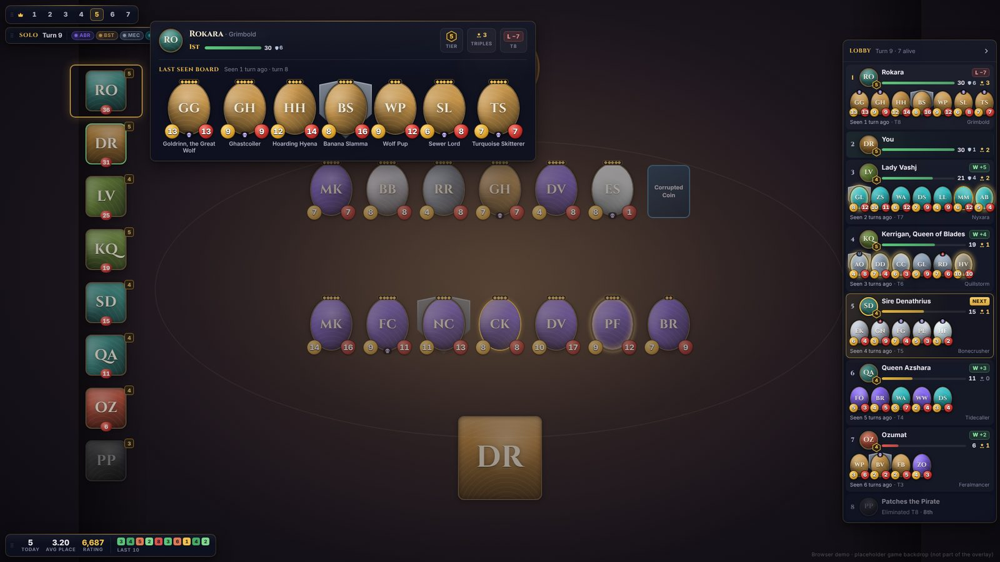
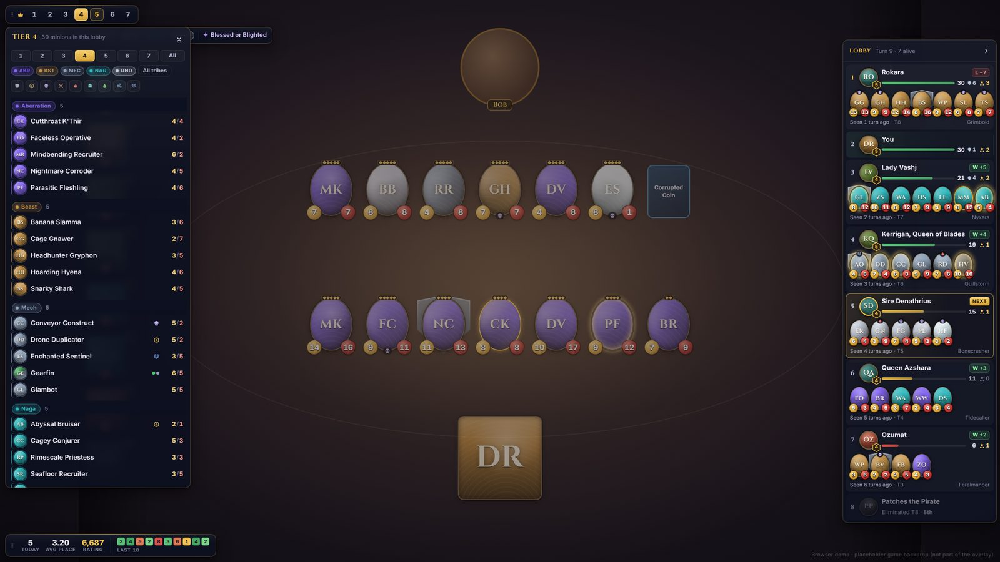
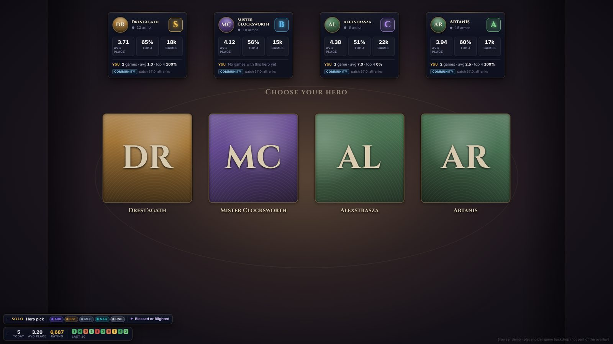
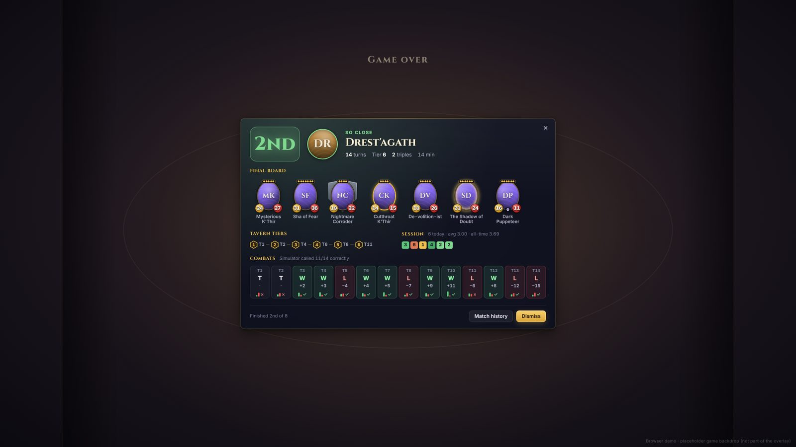
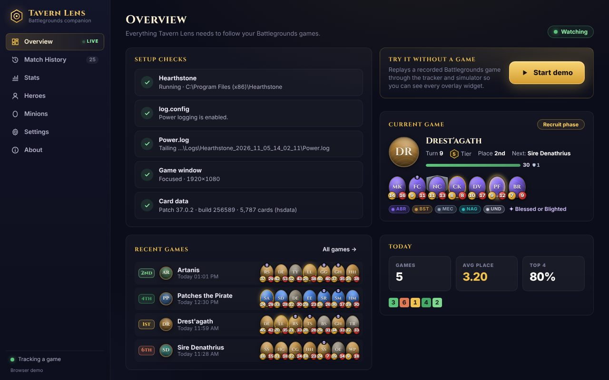
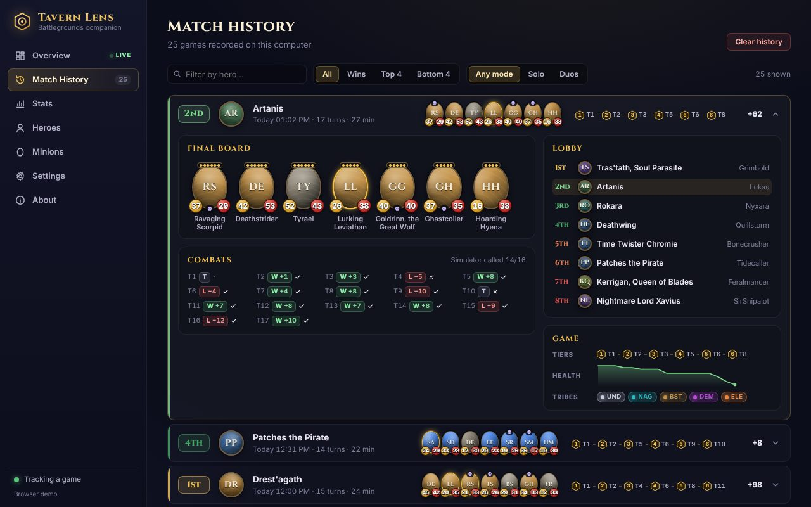

# Tavern Lens — Hearthstone Battlegrounds overlay

Tavern Lens is a desktop overlay for **Hearthstone Battlegrounds** (solo and duos), in the spirit of
Firestone and Hearthstone Deck Tracker. It reads the game's own log file — no memory reading, no
injection — and draws a transparent, click-through layer on top of the game.

> Status: 1.0. Tested end-to-end against recorded real Battlegrounds games (HearthSim test data) and in a
> Linux container. The Windows/macOS window-tracking helpers have not yet been run on real hardware.

## Features

| In game | What it shows |
| --- | --- |
| **Hero selection** | A stat card above each offered hero: average placement, top-4 rate, tier (S–D) and your own record with that hero. |
| **Opponents panel** | Every player by leaderboard place: hero, health + armor, tavern tier, triples, last board seen (with golden / keyword markers), how long ago, last result against you, next-opponent highlight. |
| **Leaderboard hover** | Hover a hero on the in-game leaderboard to see that player's last board, tier and last result. Calibratable. |
| **Battle simulation** | Before each combat: win / tie / loss odds, average damage, lethal chance. Flags results as approximate when the board has effects the simulator doesn't model; shows the actual outcome afterwards. |
| **Minions by tier** | Current-pool minions and tavern spells for each tier, filtered to the lobby's tribes, with card text and highlighting of what's in the shop. |
| **Lobby info** | Mode, turn, tribes in the lobby, anomaly. |
| **Post-match summary** | Placement, final board, tier timings, combat timeline with predicted vs. actual results. |
| **Session tracker** | Games today, average placement, last 10 placements. |

The **companion window** (tray icon → *Open Tavern Lens*) has setup checks, match history, personal stats,
a hero tier list, a full minion browser and all settings. A **demo mode** replays a recorded game so you
can see everything without launching Hearthstone.

### Screenshots

The overlay screenshots come from the browser demo, which draws a placeholder game behind the overlay.
Card art is loaded from HearthstoneJSON at runtime and couldn't be fetched where these were captured, so
minions show their initials instead of art.

| | |
| --- | --- |
|  Recruit phase: tier bar, lobby info, opponents panel, session widget |  Battle simulation with the actual result |
|  Leaderboard hover |  Minions by tier |
|  Hero selection |  Post-match summary |
|  Companion: overview and setup checks |  Companion: match history |

More in [`docs/screenshots/`](docs/screenshots/); regenerate them with `node docs/screenshots/capture.mjs`
while `npm run demo:web` is running.

## Install & run

Requirements: Windows 10/11 or macOS, Hearthstone installed, Node.js 22+ (to build from source).

```bash
cd hs-battlegrounds-overlay
```

```bash
npm install
```

```bash
npm run dev
```

To build an installer (`release/`):

```bash
npm run dist:win
```

```bash
npm run dist:mac
```

CI (`.github/workflows/tavern-lens.yml`) also builds Windows and macOS packages and uploads them as
workflow artifacts. The packages are unsigned, so Windows SmartScreen / macOS Gatekeeper will warn on
first launch.

### First launch

1. Tavern Lens finds your Hearthstone install (registry / default paths; you can pick it manually in
   Settings) and enables Hearthstone's `Power` log in `log.config`. **If Hearthstone was already running,
   restart it once** so the log setting takes effect.
2. Start a Battlegrounds game. The overlay appears over the game window while Hearthstone is focused.
3. Hotkeys (active while Hearthstone is in front): `Ctrl/Cmd+Shift+H` toggle overlay, `Ctrl/Cmd+Shift+T` tier list, `Ctrl/Cmd+Shift+O`
   opponents panel (configurable).
4. On macOS, grant Accessibility permission so the overlay can follow the Hearthstone window; without it
   the overlay covers the main display.

Hearthstone must run in windowed or borderless ("fullscreen window") mode for any overlay to be visible.

## How it works

```
Power.log ──► log tailer ──► BgTracker (parser + entity store + BG rules) ──► BgGameState / events
                (main)            src/core/log, game, bg                          │ IPC
                                                                                  ▼
             history.json ◄── match records             overlay + companion windows (React)
                                                                    │
                                                         battle simulator (Web Worker, src/core/sim)
```

- **`src/core/log`, `src/core/game`, `src/core/bg`** — streaming `Power.log` parser, entity/tag store and the
  Battlegrounds tracker (players, leaderboard, boards seen at combat start, combat results, tribes,
  anomaly, duos teammates, match records). See `src/core/bg/README.md` for the log quirks it handles.
- **`src/core/sim`** — an original Monte-Carlo combat simulator with a per-card effect registry. See
  `src/core/sim/README.md` for coverage and how to add cards.
- **`src/core/cards`** — card data for the current patch, generated from HearthSim's
  [hsdata](https://github.com/HearthSim/hsdata) (`CardDefs.Bacon.xml`), refreshed at runtime when a new
  Hearthstone build ships. Regenerate the bundled copy with `npm run cards`.
- **`src/main`** — Electron main process: Hearthstone discovery, `log.config`, log tailing, game-window
  tracking (PowerShell helper on Windows, AppleScript on macOS), tray, hotkeys, persistence, demo mode,
  hero stats.
- **`src/renderer`** — React overlay widgets and the companion window.

### Data sources

- Card data: HearthSim hsdata (bundled + auto-refresh).
- Card art: [HearthstoneJSON](https://hearthstonejson.com/) image CDN (can be turned off in Settings).
- Hero stats: your own match history, plus optional community statistics from Firestone's public data
  files (Settings → *Community hero stats*).
- Test fixtures and the demo game: [HearthSim hsreplay-test-data](https://github.com/HearthSim/hsreplay-test-data) (CC0).

All match history stays on your machine (`%APPDATA%/Tavern Lens` on Windows,
`~/Library/Application Support/Tavern Lens` on macOS).

## Development

```bash
npm test
```

```bash
npm run typecheck
```

`npm run demo:web` serves the UI in a normal browser with sample scenes
(`?scene=heroSelection|recruit|combat|gameOver|replay&window=overlay|settings`).

## Known limitations

- Hearthstone's log has no MMR, so rating tracking is manual.
- The lobby's tribes are inferred from the minions offered in the shop until enough have been seen.
- The simulator implements the in-combat effects of 111 of the 302 current-pool minions; the other 189
  were checked one by one and have no effect inside combat (their stats and keywords are simulated).
  Some trinkets, hero powers and older cards aren't modelled; results involving them are marked
  *approximate* and list the cards. Start-of-combat ordering between the two sides is a best estimate.
- Leaderboard hover zones assume the standard Hearthstone layout; use the calibration sliders if they're
  offset on your resolution.

Tavern Lens is a fan project, not affiliated with or endorsed by Blizzard Entertainment.
