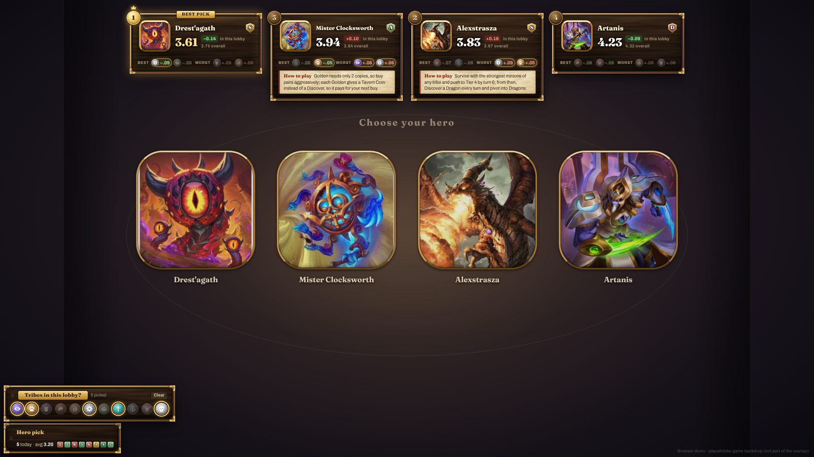
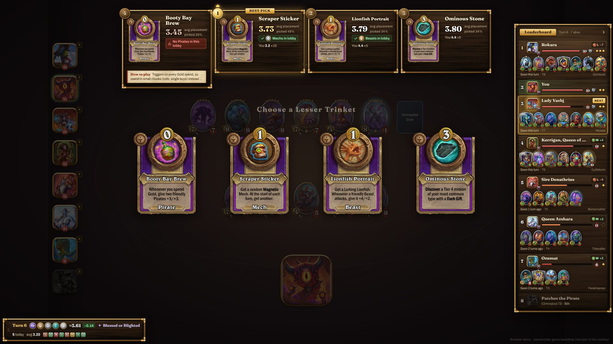
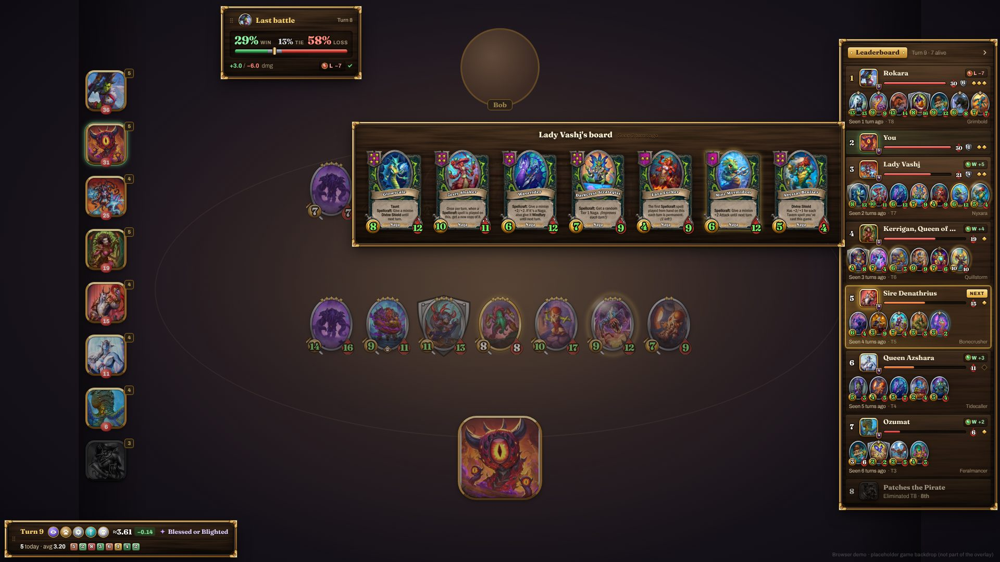
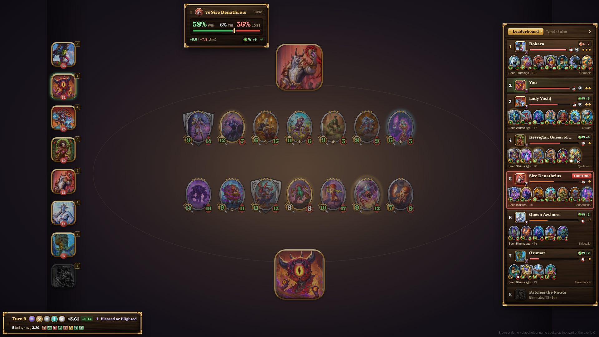
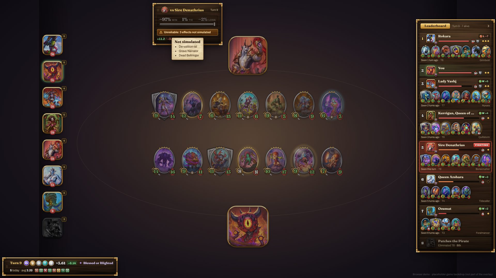
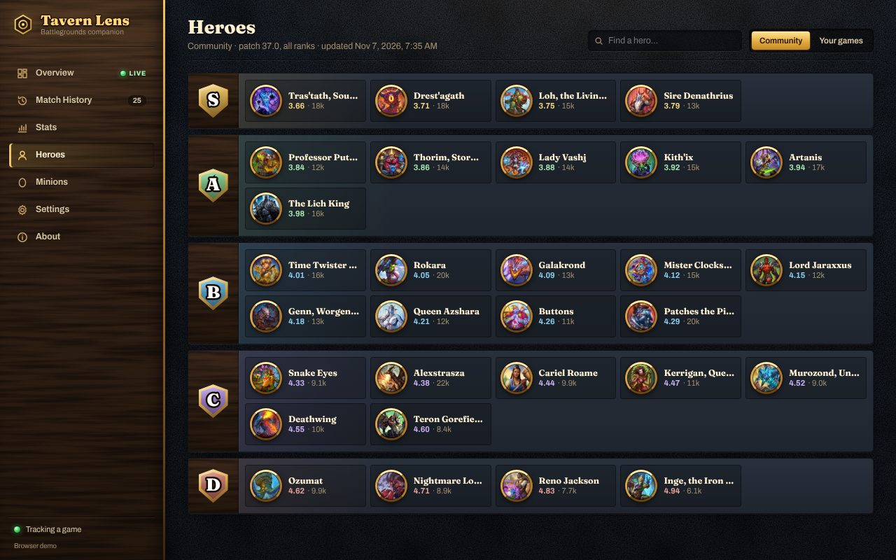
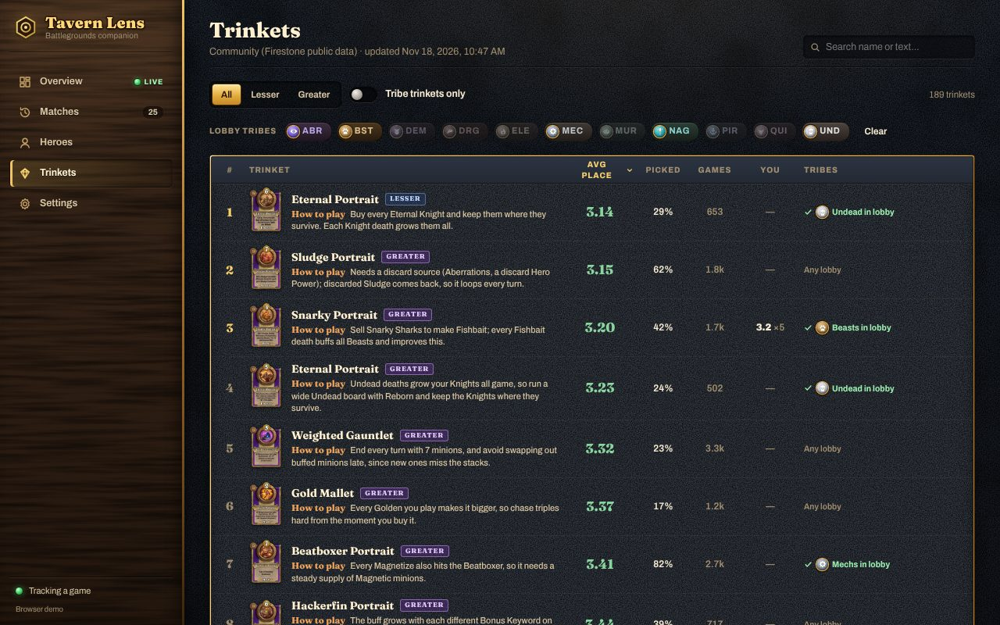

# Tavern Lens — Hearthstone Battlegrounds overlay

Tavern Lens is a desktop overlay for **Hearthstone Battlegrounds** (solo and duos), in the spirit of
Firestone and Hearthstone Deck Tracker. It reads the game's own log file — no memory reading, no
injection — and draws a transparent, click-through layer on top of the game.

> Status: 1.0. Tested end-to-end against recorded real Battlegrounds games (HearthSim test data) and in a
> Linux container. The Windows/macOS window-tracking helpers have not yet been run on real hardware.

## Features

| In game | What it shows |
| --- | --- |
| **Hero pick ranking** | Above each offered hero: its rank among the offer (#1 gets a crown and "Best pick"), expected placement, the tribes it does best and worst with, and a short "How to play" note. Tick the lobby's tribes on the tribe picker (11 emblems, mouse only) and the heroes are re-ranked for this lobby; once the game reveals the tribes they are used automatically. More numbers on hover. |
| **Trinket pick ranking** | Above each offered trinket (lesser and greater): the game's own card, its rank by average placement, pick rate, a check or warning for the tribes it needs in this lobby (a trinket whose tribe is missing ranks last) and how to play it. |
| **Opponents panel** | Every player by leaderboard place: hero, health + armor, tavern tier, triples, last board seen, last result against you, next-opponent highlight. Hover a row to see that board as the game's cards with their current stats; click a row for trinkets, tier timings and health history. |
| **Battle odds** | One compact plaque: win / tie / loss, average damage, lethal chance when there is any, and the actual result afterwards (it stays through the next shop as "Last battle"). When the boards contain effects the simulator doesn't model, the odds are greyed out behind "Unreliable: N effects not simulated" (the cards are listed on hover) instead of being shown as confident numbers. |
| **Counters** | A small panel beside the game's refresh button: Blood Gem stats, Beetle stats, extra (or overdrawn) Gold next turn and free refreshes. Each appears only when it applies. |
| **Lobby and session plaque** | One small plaque: turn, the lobby's tribes, your hero's expected placement in this lobby, the anomaly; games today, average and recent placements. Details on hover. |
| **Post-match summary** | Placement, final board as the game's cards, tier timings, combat timeline with predicted vs. actual results, on a scroll docked at the right edge. Closes with its button, any overlay hotkey, or by itself after 40 s (paused while hovered). |

The **companion window** (tray icon → *Open Tavern Lens*) has five pages: **Overview** (setup checks and the
current game), **Matches** (history and statistics), **Heroes** and **Trinkets** (ranked lists with a tribe
filter that re-ranks them for a lobby, per-tribe effects, your own record and "How to play" notes) and
**Settings** (with diagnostics and about). A **demo mode** replays a recorded game so you can see everything
without launching Hearthstone.

### Screenshots

The overlay screenshots come from the browser demo, which draws a placeholder game behind the overlay.
Minions, trinkets and heroes are drawn with the game's own card renders and art from HearthstoneJSON; with
card images turned off they fall back to cards drawn from the card data.

| | |
| --- | --- |
|  Hero pick: heroes ranked for the lobby's tribes |  Trinket pick: ranked offer, missing-tribe warning |
|  Recruit phase: last battle, leaderboard panel, lobby and session plaque |  Hovering an opponent: their board as cards |
|  Battle odds with the actual result |  Odds flagged as unreliable |
|  Post-match summary |  Companion: overview and setup checks |
|  Companion: heroes ranked for a lobby |  Companion: trinkets |

More in [`docs/screenshots/`](docs/screenshots/); regenerate them with `node docs/screenshots/capture.mjs`
while `npm run demo:web` is running.

## Install & run

Requirements: Windows 10/11 or macOS, Hearthstone installed, Node.js 22+ (to build from source).

```bash
cd hs-battlegrounds-overlay
```

```bash
npm install
```

```bash
npm run dev
```

To build an installer (`release/`):

```bash
npm run dist:win
```

```bash
npm run dist:mac
```

CI (`.github/workflows/tavern-lens.yml`) also builds Windows and macOS packages and uploads them as
workflow artifacts. The packages are unsigned, so Windows SmartScreen / macOS Gatekeeper will warn on
first launch.

### First launch

1. Tavern Lens finds your Hearthstone install (registry / default paths; you can pick it manually in
   Settings) and enables Hearthstone's `Power` log in `log.config`. **If Hearthstone was already running,
   restart it once** so the log setting takes effect.
2. Start a Battlegrounds game. The overlay appears over the game window while Hearthstone is focused.
3. Hotkeys (active while Hearthstone is in front): `Ctrl/Cmd+Shift+H` toggle overlay, `Ctrl/Cmd+Shift+O`
   opponents panel (configurable).
4. On macOS, grant Accessibility permission so the overlay can follow the Hearthstone window; without it
   the overlay covers the main display.

Hearthstone must run in windowed or borderless ("fullscreen window") mode for any overlay to be visible.

## How it works

```
Power.log ──► log tailer ──► BgTracker (parser + entity store + BG rules) ──► BgGameState / events
                (main)            src/core/log, game, bg                          │ IPC
                                                                                  ▼
             history.json ◄── match records             overlay + companion windows (React)
                                                                    │
                                                         battle simulator (Web Worker, src/core/sim)
```

- **`src/core/log`, `src/core/game`, `src/core/bg`** — streaming `Power.log` parser, entity/tag store and the
  Battlegrounds tracker (players, leaderboard, boards seen at combat start, combat results, tribes,
  anomaly, duos teammates, match records). See `src/core/bg/README.md` for the log quirks it handles.
- **`src/core/sim`** — an original Monte-Carlo combat simulator with a per-card effect registry. See
  `src/core/sim/README.md` for coverage and how to add cards.
- **`src/core/cards`** — card data for the current patch, generated from HearthSim's
  [hsdata](https://github.com/HearthSim/hsdata) (`CardDefs.Bacon.xml`), refreshed at runtime when a new
  Hearthstone build ships. Regenerate the bundled copy with `npm run cards`.
- **`src/main`** — Electron main process: Hearthstone discovery, `log.config`, log tailing, game-window
  tracking (PowerShell helper on Windows, AppleScript on macOS), tray, hotkeys, persistence, demo mode,
  hero stats.
- **`src/renderer`** — React overlay widgets and the companion window.

### Data sources

- Card data: HearthSim hsdata (bundled + auto-refresh).
- Card art: [HearthstoneJSON](https://hearthstonejson.com/) image CDN (can be turned off in Settings).
- Hero stats: your own match history, plus optional community statistics from Firestone's public data
  files (Settings → *Community hero stats*).
- Test fixtures and the demo game: [HearthSim hsreplay-test-data](https://github.com/HearthSim/hsreplay-test-data) (CC0).

All match history stays on your machine (`%APPDATA%/Tavern Lens` on Windows,
`~/Library/Application Support/Tavern Lens` on macOS).

## Reporting a problem

Tavern Lens keeps a rotating log of what it sees and does (`logs/tavern-lens.log`) and a record of every
simulated combat with its actual outcome (`logs/sim-cases.jsonl`) in its data folder. After playing, open
Tavern Lens → **About → Diagnostics → Export diagnostics**: it saves one `TavernLens-diagnostics-….zip` to
your Desktop with the logs, settings, recent matches and (optionally) your latest Hearthstone `Power.log`.
Attach that zip to a bug report. It contains your BattleTag and your opponents' names. Turn on
**Verbose logging** there to capture more detail while reproducing a problem.

## Development

```bash
npm test
```

```bash
npm run typecheck
```

`npm run demo:web` serves the UI in a normal browser with sample scenes
(`?scene=heroSelection|trinketPick|recruit|combat|gameOver|replay&window=overlay|settings`).

## Known limitations

- Hearthstone's log has no MMR, so rating tracking is manual.
- Hearthstone's log does not list the lobby's tribes: tick them on the hero-pick tribe picker, or wait until
  they are inferred from the minions offered in the shop (turn 1–2).
- Lobby-adjusted placements add up one-tribe-at-a-time community statistics, so they are estimates.
- The simulator implements the in-combat effects of 111 of the 302 current-pool minions; the other 189
  were checked one by one and have no effect inside combat (their stats and keywords are simulated).
  Trinkets, hero powers, quest rewards and anomalies are modelled except Lock and Load / Deadeye after
  use, Assembler Portrait and two greater trinkets; older cards missing from the card data aren't. Results
  involving them are marked *unreliable* and list the cards (3 of 275 recent live fights). Start-of-combat
  ordering between the two sides is a best estimate.

Tavern Lens is a fan project, not affiliated with or endorsed by Blizzard Entertainment.
